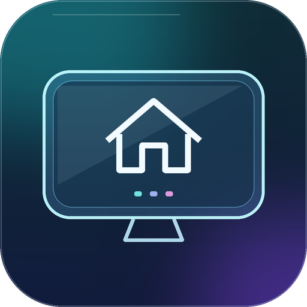
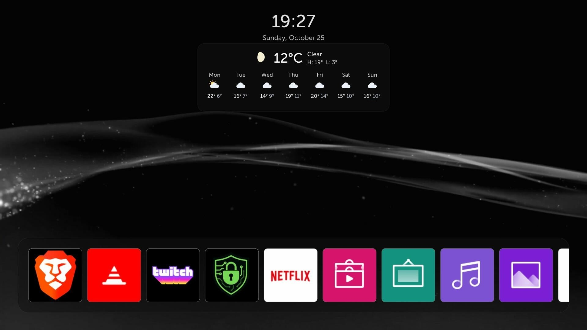
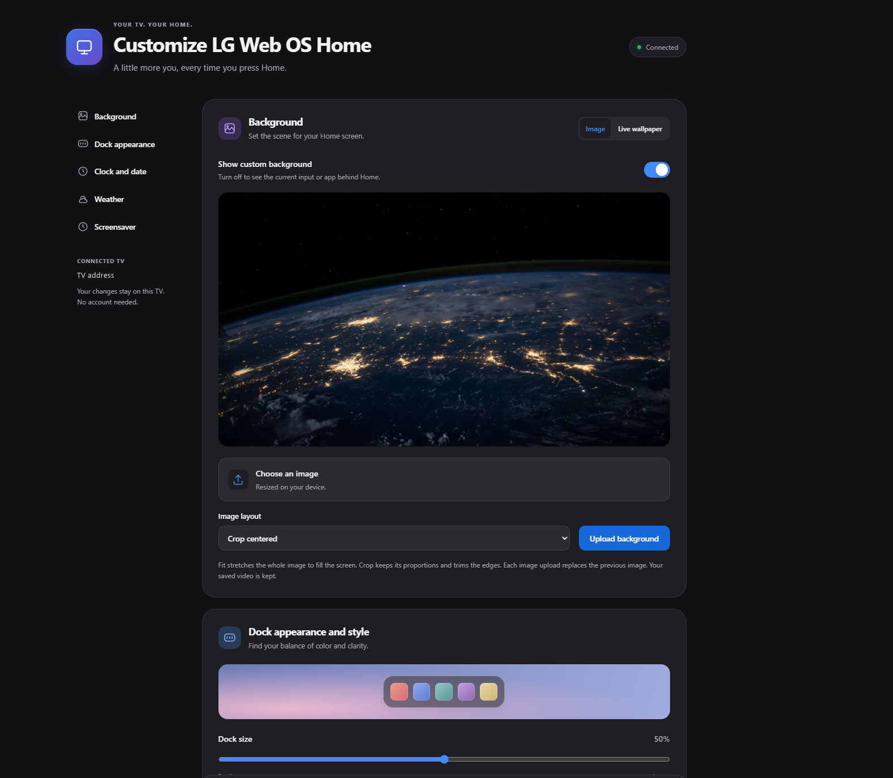

<p align="center"></p>

# LG webOS Glass Home

**Version 1.0** - Make your native LG Home screen your own.

This **does not replace webOS** or install a different operating system. It modifies the appearance, configuration, and behavior of the existing Home screen while keeping native apps and inputs.

This was inspired by the "Glass Home" project for Samsung TVs, available [here](https://github.com/victaphu/glass-home-samsung-tv).

<p align="center"></p>

## Features

1. Image backgrounds or looping live video wallpapers.
2. Adjustable app dock size, color, opacity, and borders.
3. Optional clock and date, with 12- or 24-hour time.
4. Current weather and a seven-day forecast for your chosen city, in Celsius or Fahrenheit.
5. Choose the TV's built-in LG fireworks animation or DVD-bounce screensaver, with an adjustable Home idle timer from 10 seconds to 5 minutes. The selected animation also appears outside Home whenever the TV's system screensaver runs.
6. Persistent startup and wake support, with settings saved on the TV.
7. Setup enables LG **Q Start+** for quick access to Home after standby.

## Install

Tested on **LG OLED55B9PSB**, firmware **05.50.00 / webOS 4.10.2**. Requires an already-rooted TV with a compatible, elevated **Homebrew Channel** service. Other models and firmware versions are not confirmed; setup checks compatibility before applying changes.

1. Install `org.webosbrew.b9homecustom_1.0.0_all.ipk` using your webOS package installer.
2. Open **LG webOS Glass Home** once and wait for setup to report success. Installing the IPK alone does not apply the customization.
3. Press **Home** to use your customized screen.

**Cold boot (starting from completely off):** Allow around **40-60 seconds**. The TV starts on its last input, then opens custom Home when ready.

**Normal power off/on (standby):** Home returns in about **2 seconds** with **Q Start+**, which LG webOS Glass Home enables automatically during setup. Disconnecting power or fully restarting the TV requires another cold boot.

Removing the LG webOS Glass Home app alone does not restore stock Home.

## Restore stock Home before uninstalling

Reopen **LG webOS Glass Home**, point to **Restore stock Home**, then click. Reopening an existing installation does not automatically reapply setup or launch Home, so the restore button stays available. The restore button requires a mouse or Magic Remote pointer hover and click; keyboard activation does not trigger it.

This restores the saved **pre-install settings**, not a factory reset: native Home and screensaver behavior, Q Start+, startup policy, and Home-specific picture/idle overrides are reverted. The custom settings website and automatic Home startup/wake support are stopped. HDMI calibrations and unrelated services are left alone; saved wallpapers, preferences, and recovery backups are retained on the TV.

Wait for **Stock Home configuration restored**, **fully restart the TV (not just standby)**, then uninstall the app. If restoration does not finish, keep the app installed and use **Restore stock Home** again to resume.

## Customize from your browser

The settings website runs directly on the TV. On a phone or computer connected to the **same local network**, open:

```text
http://<TV-IP>/
```

Replace `<TV-IP>` with the IP address shown when you hover over the **?** help icon in the **top-right corner of Home**. (This icon can be hidden from the web interface.) For example: `http://192.168.1.50/`.

<p align="center"></p>

The default background image and looping live wallpaper are included. Upload a different image or a compatible **H.264 MP4** live wallpaper up to **3840 x 2160 (4K), 60 fps and 150 MB**, adjust the dock, clock, weather, and screensaver, then select **Save changes**. No account or separate PC server is needed.

Weather starts **off**, with no saved city. Choose your city and enable weather to show the forecast; weather data requires internet access and is provided by Open-Meteo.

## Build from source

See [BUILDING.md](BUILDING.md) for build and test commands. The public IPK contains no LG firmware source; overlays are generated from matching firmware already on the TV. Existing uploaded media is preserved during upgrades.
